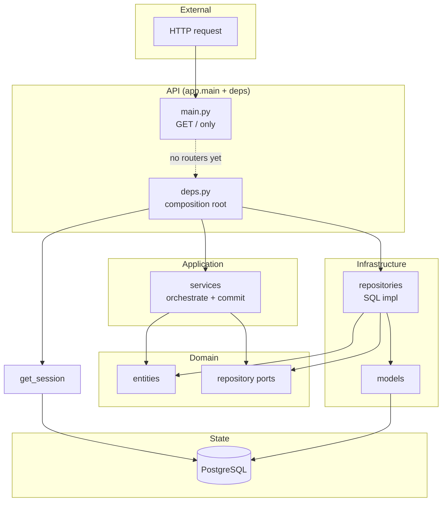

# Architecture Brief — Reasoning and Report

---

## Internal reasoning (questions answered first)

**What is the entry point of this application?**  
The runtime entry point is **`app.main:app`** — the FastAPI application instance. The Dockerfile runs `uvicorn app.main:app --host 0.0.0.0 --port 8000` after `alembic upgrade head`. The repo root has a `main.py` that is a stub (prints "Hello from admin-service!"); it is not used by Docker or uvicorn. So the *application* entry is `app/main.py`; the *process* is uvicorn loading that app.

**What triggers processing — HTTP, events, CLI, cron?**  
**HTTP only.** There are no references to Celery, Redis, cron, schedulers, event buses, or queue workers. FastAPI handles incoming HTTP; the only route defined is `GET /` returning `{"status":"ok"}`. No CLI commands, no background jobs, no event-driven pipelines. All processing would be request/response.

**Where does state live — DB, cache, memory, external service?**  
**PostgreSQL only** for persistent state. `app/db/session.py` builds an async engine from `settings.DATABASE_URL` (asyncpg). No Redis or other cache; no in-memory stores for business data; the only “global” is the engine/session factory (created at import time). Config lives in environment (Pydantic-settings). So: DB + env. Session is per-request (async generator), so no shared request state across connections.

**Where is business logic? Is it isolated or scattered?**  
**Isolated.** Domain rules and structure live in `app/domain/` (entities, repository ports, domain exceptions) — no I/O, no frameworks. Application use-case orchestration lives in `app/services/`: build entity, call repository port, commit. Repositories in `app/repositories/` only map ORM ↔ domain and run SQL. There is no business logic in `app/api/` (deps only wires things) or in `app/models/` (ORM definitions only). So: domain + services own logic; API and repos are thin.

**Are there clear boundaries between layers, or is it a big ball of mud?**  
**Clear boundaries.** Domain imports only stdlib and `app.domain.shared`. Services import only domain (and a local Protocol for commit). Repositories import domain + models + SQLAlchemy. API (deps) imports db, repositories, and services — it is the only place that ties infra to app. No circular dependencies; no domain or service importing API, schemas, or ORM. Layer contracts doc confirms: no violations. It’s a layered/hexagonal layout, not a big ball of mud.

**What would break first under 10x load?**  
(1) **Database or connection pool** — single PostgreSQL, one pool per process, no read replicas or caching; all reads/writes hit the same DB. (2) **No horizontal scaling strategy in code** — no rate limiting, circuit breaker, or backpressure; scaling would be “more replicas + load balancer” with shared DB. (3) **Trivial API surface** — today only `GET /` exists, so “10x load” is almost meaningless until routers are mounted and real endpoints run; then the first bottleneck is likely DB/pool.

---

## 1. Architecture summary (one paragraph)

The project is a **layered, hexagonal-style backend**: a FastAPI app with a pure domain at the centre (entities, repository ports, domain exceptions), an application layer (services that orchestrate repositories and commit transactions), and infrastructure adapters (SQL repositories and ORM models). The only composition root is `app/api/deps.py`, which wires a request-scoped AsyncSession, concrete SQL repositories, and services for dependency injection. State lives in PostgreSQL; there are no event buses, background workers, or caches. Boundaries between domain, services, repositories, and API are respected and there are no circular dependencies. The design is ready to scale from an architectural standpoint, but the HTTP surface is unfinished — no routers are mounted beyond a single health-style `GET /` — so the wired services are not yet exposed.

---

## 2. Layer map with responsibilities

| Layer | Location | Responsibility |
|-------|----------|-----------------|
| **API / Presentation** | `app/main.py`, `app/api/` | Expose HTTP; composition root in `deps.py` wires session, repos, and services. Routers (agents, documents, etc.) exist as files but are empty and not mounted. |
| **Schemas** | `app/schemas/` | Pydantic request/response and validation; `PaginatedResponse` and resource DTOs. No dependency on domain or infrastructure. |
| **Application services** | `app/services/` | Orchestrate use cases: build domain entities, call repository port, commit session on writes. Depend only on domain and a commit Protocol. |
| **Domain** | `app/domain/` | Entities (dataclasses), repository ABCs (ports), domain exceptions. No framework or I/O; stdlib and `app.domain.shared` only. |
| **Repositories** | `app/repositories/` | Implement domain repository ports with SQLAlchemy async; map ORM ↔ domain; flush only (no commit). |
| **ORM / Persistence mapping** | `app/models/` | SQLAlchemy declarative models and relationships; used by repositories and Alembic. |
| **DB** | `app/db/` | Engine, session factory, `get_session`, Base, uuid7. Depends on `app.config`. |
| **Config** | `app/config.py` | Load settings (e.g. `DATABASE_URL`) from environment. |

---

## 3. Diagram that best tells the story

*Solid lines: actual dependencies and data flow. Dashed: intended path not yet connected (routers not mounted).*

---

## 4. Top 3 fragility points

1. **No HTTP surface** — `app/main.py` never calls `include_router`; `app/api/agents.py` and the other router files are empty. The composition root and all services are unused from HTTP. Any “architecture” discussion is theoretical until routes are registered and handlers call the injected services. **Ref:** `app/main.py`, `app/api/*.py`.

2. **Single database and connection pool** — All state and all requests go through one PostgreSQL instance and one async engine/session factory per process. There is no caching, read replica, or connection-pool tuning visible in code. Under higher load, DB or pool saturation will be the first bottleneck. **Ref:** `app/db/session.py`, `app/config.py` (single `DATABASE_URL`).

3. **Vocabulary and mapping drift** — Domain and ORM/schemas use different names and enums (e.g. document status: domain `pendiente`/`indexado`/`error` vs ORM `indexing`/`indexed`/`error`; use case `pregunta`/`respuesta` vs ORM `question`/`answer`). Mapping is done in repositories and services but is easy to break when adding fields or new code paths. **Ref:** `app/domain/documents/entity.py`, `app/models/document.py`; `app/domain/use_cases/entity.py`, `app/models/use_case.py`.
