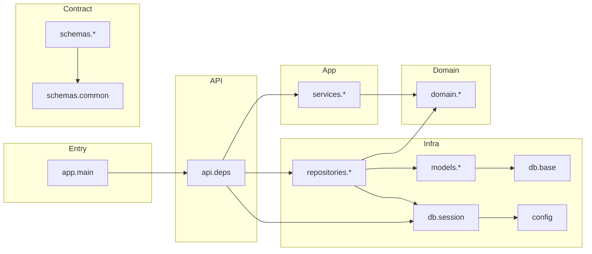

# Architectural State-of-the-Project Report

*Evidence-based audit of admin-service. Precision over assumption; ambiguities called out.*

---

## 1. FOLDER STRUCTURE

```
.
├── alembic/                    # Migration scripts and env; runs async upgrades against PostgreSQL.
├── alembic/versions/           # Revision files (e.g. 12afebdd90a9_initial.py).
├── app/
│   ├── api/                    # HTTP entrypoints and composition root; FastAPI routers and DI.
│   ├── config.py               # Pydantic-settings; loads DATABASE_URL from env/.env.
│   ├── db/                     # SQLAlchemy engine, session, Base; no business logic.
│   │   └── migrations/         # Empty package (Alembic lives at repo root).
│   ├── domain/                 # DDD core; entities, repository ports, domain exceptions.
│   │   ├── agents/
│   │   ├── documents/
│   │   ├── prompts/
│   │   ├── shared/             # Shared domain primitives (e.g. DomainException).
│   │   ├── tools/
│   │   └── use_cases/
│   ├── main.py                 # FastAPI app instance; currently only GET / (routers not mounted).
│   ├── models/                 # SQLAlchemy ORM; persistence mapping only.
│   ├── repositories/           # Concrete implementations of domain repository ports (SQL).
│   ├── schemas/                # Pydantic request/response models; API contract.
│   └── services/               # Application services; orchestrate repo + transaction (commit).
├── docs/                       # Schema docs, migrations guide, this report.
├── tests/                      # unit/ and integration/ (structure present; coverage TBD).
├── Dockerfile                  # Multi-stage build; runtime runs alembic upgrade + uvicorn.
├── docker-compose.yml          # api + postgres; DATABASE_URL for api service.
├── main.py                     # Stub CLI entrypoint ("Hello from admin-service!").
└── pyproject.toml              # Dependencies, Ruff, uv; requires-python >=3.11.
```

---

## 2. ARCHITECTURE STYLE

**Primary: Layered + Hexagonal (Ports & Adapters) with DDD bounded contexts.**

**Evidence:**

- **Domain at the centre:** `app/domain/` contains entities (dataclasses), repository **abstract** interfaces (ABCs), and domain exceptions. No imports of FastAPI, SQLAlchemy, or Pydantic — only stdlib and in-domain packages (`app.domain.shared`, sibling domains). This is the “core” with no infrastructure dependencies.
- **Ports:** Repository ABCs in `app/domain/*/repository.py` define the persistence port (e.g. `AgentRepository` with `get`, `list`, `create`, `update`, `delete`). Services depend on these abstractions, not concrete repos.
- **Adapters:** `app/repositories/*.py` implement those ABCs using SQLAlchemy `AsyncSession` and ORM models from `app/models/`. They map ORM ↔ domain entities and are the only place that knows both `app.domain` and `app.models`.
- **Application layer:** `app/services/*.py` orchestrate use cases: they receive a repository (injected) and a session (for `commit()`). They work with domain entities and domain exceptions only.
- **Composition root:** `app/api/deps.py` is the single place that imports both concrete repositories and services; it wires `get_session → repo(session) → service(repo, session)` per resource. Routers are intended to depend only on services (and schemas), not repos.
- **Bounded contexts:** Domain is split by aggregate: `agents`, `documents`, `prompts`, `use_cases`, `tools` (with `shared`). Each has its own entity, repository port, and exceptions.

**Not in use:** No CQRS (same model for read/write), no event bus or event-driven flows, no MVC (no “controller” layer name; API handlers play that role).

---

## 3. LAYER-BY-LAYER BREAKDOWN

### 3.1 API (Presentation / HTTP)

| Aspect | Content |
|--------|--------|
| **Responsibility** | Expose HTTP endpoints; validate request bodies (schemas); call services; return responses. |
| **Key files** | `app/main.py` (FastAPI app), `app/api/deps.py` (composition root), `app/api/agents.py`, `documents.py`, `prompts.py`, `use_cases.py`, `tools.py` (routers). |
| **Depends on** | FastAPI, `app.db.session.get_session`, `app.repositories.*` (in deps only), `app.services.*`, `app.schemas.*`. |
| **Exposed to** | Uvicorn/Docker (mounts `app.main:app`). |
| **Violations / smells** | **Routers are empty** — `app/api/agents.py` (and the other router files) contain no routes; `main.py` does not `include_router` for any of them. So the “API layer” is only the composition root and a single `GET /`. |

---

### 3.2 Schemas (API contract)

| Aspect | Content |
|--------|--------|
| **Responsibility** | Pydantic v2 models for request/response; validation and serialization; no business logic. |
| **Key files** | `app/schemas/common.py` (`PaginatedResponse[T]`, `ErrorResponse`), `agents.py`, `documents.py`, `prompts.py`, `use_cases.py`, `tools.py`. |
| **Depends on** | Pydantic, `app.schemas.common` (resource schemas import common only). No `app.domain`, `app.models`, or FastAPI. |
| **Exposed to** | API layer (when routers are implemented) and OpenAPI. |
| **Violations / smells** | None. Common has no resource imports to avoid circular deps. |

---

### 3.3 Application services

| Aspect | Content |
|--------|--------|
| **Responsibility** | Orchestrate use cases: build domain entities from dicts, call repository port, commit session on writes. |
| **Key files** | `app/services/agents.py`, `documents.py`, `prompts.py`, `use_cases.py`, `tools.py`. |
| **Depends on** | `app.domain.*` (entity, repository ABC, exceptions). Session is a `_CommitSession` Protocol (async `commit()`); no SQLAlchemy type in service code. |
| **Exposed to** | `app.api.deps` (instantiates services); routers will `Depends(get_*_service)`. |
| **Violations / smells** | None. Services are async and do not touch ORM or HTTP. |

---

### 3.4 Domain

| Aspect | Content |
|--------|--------|
| **Responsibility** | Define aggregates (entities), repository ports (ABCs), and domain exceptions; pure business concepts. |
| **Key files** | `app/domain/*/entity.py`, `*/repository.py`, `*/exceptions.py`, `shared/exceptions.py`. |
| **Depends on** | Stdlib only (`dataclasses`, `abc`, `datetime`, `uuid`, etc.) and sibling/subdomain packages (e.g. `app.domain.shared`). |
| **Exposed to** | Services and repositories; Alembic env imports `app.models` (not domain) for metadata. |
| **Violations / smells** | None. Domain is free of framework and infra imports. |

---

### 3.5 Repositories (Infrastructure / persistence adapter)

| Aspect | Content |
|--------|--------|
| **Responsibility** | Implement domain repository ports using SQLAlchemy 2.0 async; map ORM ↔ domain; flush only (no commit). |
| **Key files** | `app/repositories/agents.py`, `documents.py`, `prompts.py`, `use_cases.py`, `tools.py`. |
| **Depends on** | `app.domain.*` (entity, repository ABC, exceptions), `app.models.*` (ORM), `sqlalchemy.ext.asyncio.AsyncSession`. |
| **Exposed to** | Only `app.api.deps` (and tests); routers do not import repos. |
| **Violations / smells** | None. Single responsibility; no business logic. |

---

### 3.6 ORM / persistence mapping

| Aspect | Content |
|--------|--------|
| **Responsibility** | Declarative table mapping; relationships and constraints; used by repos and Alembic. |
| **Key files** | `app/models/__init__.py` (exports all), `agent.py`, `agent_tool.py`, `document.py`, `prompt_version.py`, `tool.py`, `use_case.py`. |
| **Depends on** | `app.db.base.Base`, `app.db.uuid_default` (uuid7), SQLAlchemy; models reference each other (e.g. Agent → Document) and enums. |
| **Exposed to** | Repositories, Alembic `env.py` (via `import app.models` for `target_metadata`). |
| **Violations / smells** | None. Clear separation from domain (repos do the translation). |

---

### 3.7 DB / session

| Aspect | Content |
|--------|--------|
| **Responsibility** | Create async engine (asyncpg), session factory, and `get_session` async generator for DI. |
| **Key files** | `app/db/session.py`, `app/db/base.py`, `app/db/uuid_default.py`, `app/config.py` (DATABASE_URL). |
| **Depends on** | SQLAlchemy, `app.config.settings`. |
| **Exposed to** | `app.api.deps` (Depends(get_session)), Alembic (Base; URL from env). |
| **Violations / smells** | None. |

---

## 4. DATA FLOW DIAGRAM

```mermaid
flowchart TD
    subgraph External
        Client[Client]
    end

    subgraph "API (app.api)"
        Main[main.py FastAPI app]
        Router[Routers agents/documents/...]
        Deps[deps.py get_*_service]
    end

    subgraph "Session"
        GetSession[get_session]
        Session[AsyncSession]
    end

    subgraph "Application (app.services)"
        Service[AgentService / DocumentService / ...]
    end

    subgraph "Domain (app.domain)"
        RepoPort[AgentRepository ABC]
        Entity[Agent / Document / ...]
    end

    subgraph "Infrastructure (app.repositories)"
        RepoImpl[SQLAgentRepository]
    end

    subgraph "Persistence"
        ORM[app.models BotConfig / ...]
        DB[(PostgreSQL)]
    end

    Client -->|"HTTP"| Main
    Main --> Router
    Router -->|"Depends(get_*_service)"| Deps
    Deps -->|"Depends(get_session)"| GetSession
    GetSession -->|"yield"| Session
    Deps -->|"repo(session), service(repo, session)"| RepoImpl
    Deps --> Service
    RepoImpl --> Session
    Service -->|"repo.get/create/..."| RepoPort
    RepoPort -.->|"implements"| RepoImpl
    Service -->|"session.commit()"| Session
    RepoImpl -->|"select/update/..."| ORM
    RepoImpl -->|"map to"| Entity
    ORM -->|"async engine"| DB
```

*Note: Routers are currently empty and not mounted; the flow above is the intended path once routes are registered.*

---

## 5. DEPENDENCY GRAPH



- **No circular dependencies** (no `:::danger`): dependency direction is main → api → deps → (db, repos, services); services and repos → domain; repos → models → db; schemas → common only.
- **Single cross-layer seam:** `api.deps` is the only module that imports both `app.repositories` and `app.services`.

---

## 6. KEY ARCHITECTURAL DECISIONS (ADRs)

| # | Decision | Rationale (from code) | Trade-offs |
|---|----------|----------------------|------------|
| 1 | **Commit in the service, not in the repository** | Services call `await self._session.commit()` after repo create/update/delete; repos only `flush()`. Docstrings in services state “one use-case = one transaction”. | Repos stay testable without a real DB commit; multi-repo use cases can commit once. Caller must inject session; forgetting to commit is possible. |
| 2 | **Single composition root in `app/api/deps.py`** | Only file that imports both concrete repos and services; each `get_*_service` builds repo(session) then service(repo, session). | Clear seam; routers stay agnostic of repos. Adding a resource requires one new function in deps (and router). |
| 3 | **Domain has zero framework/third-party imports** | Domain modules use only stdlib and `app.domain.*`; entities are dataclasses; repository ports are ABCs. | Domain is portable and easy to test; mapping and infra live in repos/schemas. |
| 4 | **Repository port returns domain entities only** | ABCs and SQL repos return `Agent`, `Document`, etc., never ORM instances. Repos map ORM → entity in private helpers. | Clear boundary; API/schemas can be built from domain or from ORM via separate mapping if needed. |
| 5 | **Async end-to-end for I/O** | Session, repos, and services are async; FastAPI Depends on async generators/functions. | Aligns with asyncpg and non-blocking request handling; slightly more complex than sync. |
| 6 | **Pydantic schemas separate from domain entities** | Schemas live in `app/schemas/` with Create/Update/Read and optional Spanish API names (e.g. `nombre`); domain uses English (e.g. `name`). | API contract can evolve and support i18n without touching domain; mapping in router/service. |
| 7 | **Agent “delete” is soft (status=inactive)** | Implemented in SQL agent repo as `update(..., status=inactive)`; service has `deactivate(id)`. | No hard delete of agents; `deleted_at` exists on entity for future use. |
| 8 | **Alembic loads all ORM via `import app.models`** | `env.py` imports `Base` and `app.models` so `target_metadata` has all tables for autogenerate. | Single place to register models; new models must be exported in `app.models.__init__.py`. |

---

## 7. TECH STACK INVENTORY

| Library / tool | Version (from pyproject / lock) | Role |
|----------------|--------------------------------|------|
| Python | >=3.11 (pyproject); Ruff target 3.12 | Runtime |
| FastAPI | >=0.135.1 | HTTP app, DI, OpenAPI |
| Uvicorn | >=0.41.0 | ASGI server |
| Pydantic | (via pydantic-settings) | Settings, schemas (v2 style) |
| pydantic-settings | >=2.13.1 | Config from env |
| SQLAlchemy | >=2.0.48 | ORM, async engine/session |
| asyncpg | >=0.30.0 | PostgreSQL async driver |
| Alembic | >=1.18.4 | Migrations |
| uuid6 | >=2025.0.1 | UUID generation (used in models) |
| psycopg | >=3.3.3 | Listed but async path uses asyncpg |
| Ruff | >=0.15.4 (dev) | Lint/format |
| pytest / pytest-asyncio | (dev/test) | Tests |
| Docker / docker-compose | — | Run api + postgres |

---

## 8. RISK & SMELL REGISTER

- **Routers not mounted:** `app/main.py` does not `include_router` for any of the API modules; `app/api/agents.py` (and others) are empty. The composition root and services are unused from HTTP until routes are added and registered.
- **Dual entrypoints:** Root `main.py` is a stub (“Hello from admin-service!”); the FastAPI app is `app.main:app`. Dockerfile CMD uses `app.main:app`; the root `main.py` can confuse new contributors.
- **Document status vocabulary mismatch:** Domain/document entity uses Spanish status strings (`pendiente`, `indexado`, `error`); DB/ORM use English (`indexing`, `indexed`, `error`). Mapping is in the repo; any new code path that bypasses the repo could persist wrong values.
- **Schema vs domain naming drift:** API schemas use Spanish in places (e.g. `nombre`, `contenido`); domain uses English. Mapping is documented but lives in multiple layers (service build from dict, schema validation); risk of inconsistency if new fields are added in one place only.
- **No global exception handler:** `ErrorResponse` exists in schemas but `app/main.py` has no `@app.exception_handler` for domain exceptions or validation; 404/409 will be raw until handlers are added.
- **Tool catalog `nombre` slug:** DB constraint `^[a-z0-9_]+$`; task text mentioned “hyphens allowed” but implementation correctly forbids them. No risk, but docs/comments could state “no hyphens” explicitly.
- **Optional `created_at` on some Read schemas:** e.g. DocumentRead, PromptVersionRead have `updated_at` or `created_at` optional where the domain/ORM do not have that column; acceptable for forward compatibility but can confuse API consumers if they assume it is always set.

---

## 9. OPEN QUESTIONS

- **Why are the API router files empty?** Was the intent to implement routes in a later phase, or is there another entry (e.g. a different app module) that mounts them?
- **Is root `main.py` still required?** If not, removing or repurposing it would avoid confusion with `app.main`.
- **Is `storage_url` on Document intended to be persisted?** DocumentCreate and DocumentRead include `storage_url`; the domain/document entity and ORM do not. Clarify whether this is app-layer only or should be added to the schema/DB.
- **Should list endpoints return total count?** `PaginatedResponse` has `total`; repositories currently do not implement a separate count query. Need a decision on whether to add count (and where) or change the contract.
- **Policy for duplicate name on Agent create:** Service docstring says “Duplicate name surfaces from DB/repo”; no `AgentAlreadyExists` in the create path. Confirm whether the API should catch and return 409 or let the DB/repo error propagate.
