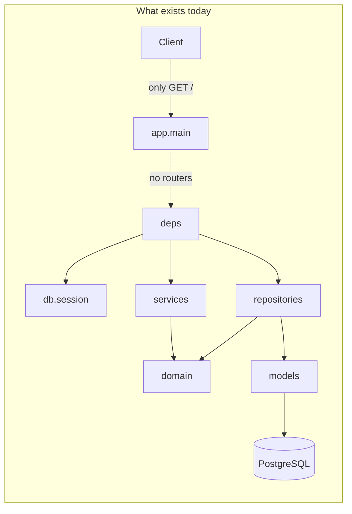

# CTO Briefing — admin-service

*30‑minute read. Blunt.*

---

## 1. What this project does

Backend admin API for managing agents (LLM config), their documents, prompt versions, use cases, and tool catalog. It is a FastAPI service with a clean/hexagonal design and PostgreSQL; **no admin endpoints are exposed yet** — only `GET /` returns `{"status":"ok"}`.

---

## 2. Architecture pattern

**Layered + Hexagonal (ports & adapters)** with DDD-style aggregates. Domain is pure (no framework imports); application services orchestrate repository ports; a single composition root in `app/api/deps.py` wires SQL repos and services; persistence lives in `app/repositories` and `app/models`.

---

## 3. Three things done well

- **Domain isolation:** `app/domain/` has no FastAPI, SQLAlchemy, or Pydantic. Entities are dataclasses; repository ports are ABCs. See e.g. `app/domain/agents/entity.py`, `app/domain/agents/repository.py` — only stdlib and `app.domain.shared`.
- **Single composition root:** All wiring of repos + services + session happens in one place. Routers are meant to depend only on services, not repos. See `app/api/deps.py` (docstring and `get_*_service` functions).
- **Clear layer contracts:** Services depend only on domain (entity, repository ABC, exceptions) and a `_CommitSession` Protocol; repos implement domain ports and map ORM ↔ entity. No layer violations. See `app/services/agents.py`, `app/repositories/agents.py`.

---

## 4. Three biggest risks or debt items

- **No API surface:** `app/main.py` never calls `include_router`; `app/api/agents.py` (and documents, prompts, tools, use_cases) are empty. The composition root and all services are unused from HTTP. You cannot demo or scale what isn’t wired. **Files:** `app/main.py`, `app/api/*.py` (routers).
- **Dual entrypoints:** Root `main.py` is a stub (“Hello from admin-service!”); the real app is `app.main:app`. New hires and tooling can hit the wrong entrypoint. **Files:** `main.py` (root), `app/main.py`.
- **Vocabulary and contract drift:** Document domain uses Spanish status (`pendiente`, `indexado`, `error`); ORM uses English (`indexing`, `indexed`, `error`). Schemas use Spanish field names in places (`nombre`, `pregunta`/`respuesta`); domain uses English. Mapping is in repos/services but is easy to break. **Files:** `app/domain/documents/entity.py` (status comment), `app/models/document.py` (DocumentStatus enum), `app/domain/use_cases/entity.py` vs `app/models/use_case.py` (question/answer).

---

## 5. One diagram: current structure

*Dashed: intended but not connected (routers not mounted). Solid: actual dependencies and data path.*

---

## 6. Recommendation

**Not in shape to scale yet.** The architecture is sound and the boundaries are clean, but the application has no real API: no routes, no use of the composition root from HTTP, and no exception handling for domain/validation errors. Priority is to **wire the existing design** (mount routers, inject services from deps, add a global exception handler and map domain exceptions to HTTP status codes). Do not refactor the layering; finish the wiring and fix the entrypoint/naming drift. After that, it is in shape to scale.
