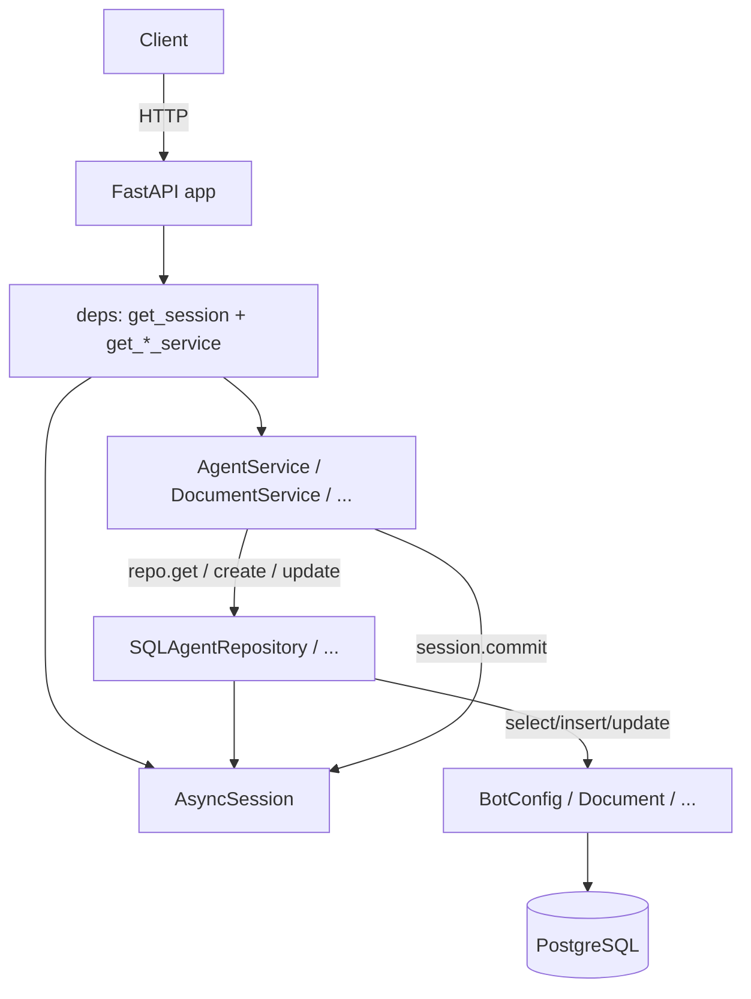
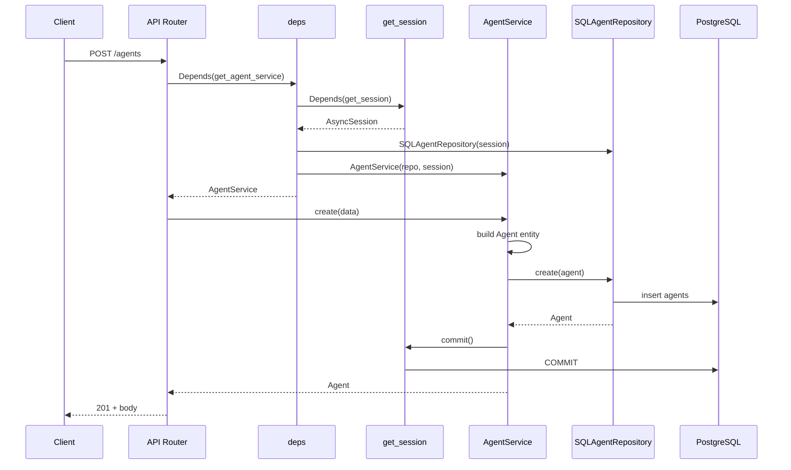
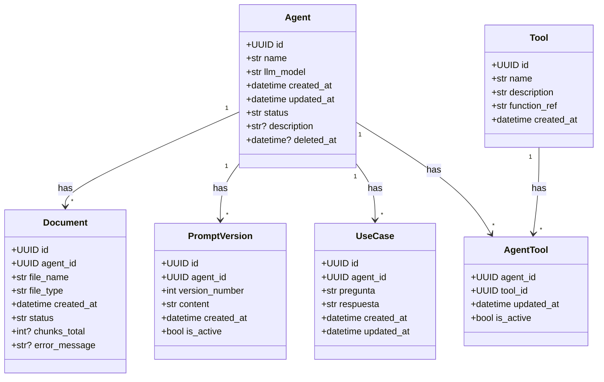
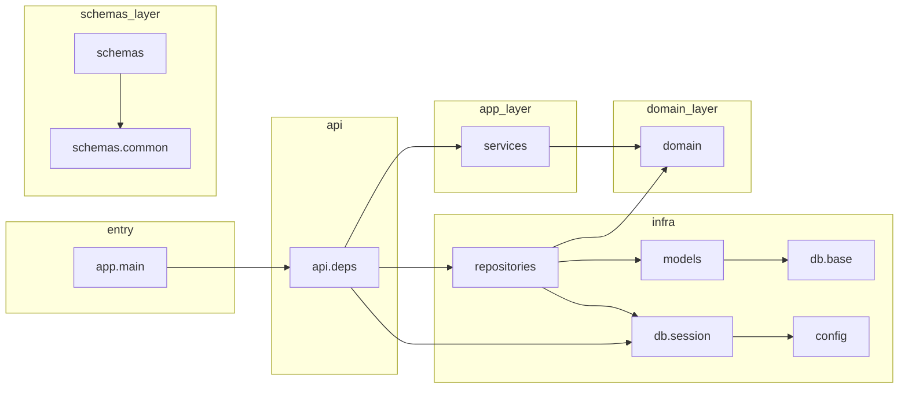
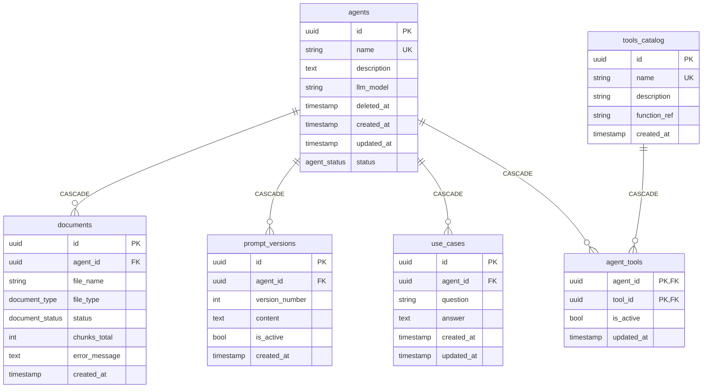
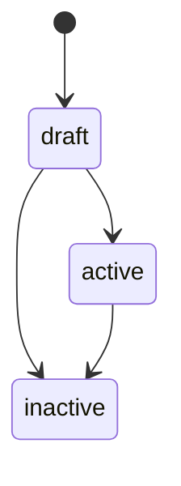
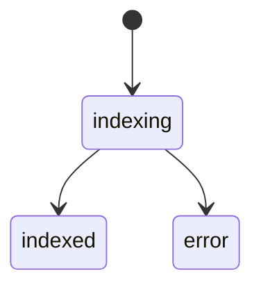

# admin-service — Diagrams

Diagrams only; one-line title per diagram. If a type does not apply, it is skipped with a one-line reason.

---

## 1. Happy-path request lifecycle (HTTP in → DB out)

---

## 2. Sequence: core use case (create agent)

---

## 3. Domain model — core entities and relationships

---

## 4. Module dependency graph (circular deps flagged)

*No circular dependencies; no `:::danger` nodes.*

---

## 5. Database schema (from ORM)

---

## 6. State machines / workflow states

*No other explicit state machines or workflow engines found in the codebase (e.g. no saga, no approval workflow).*
