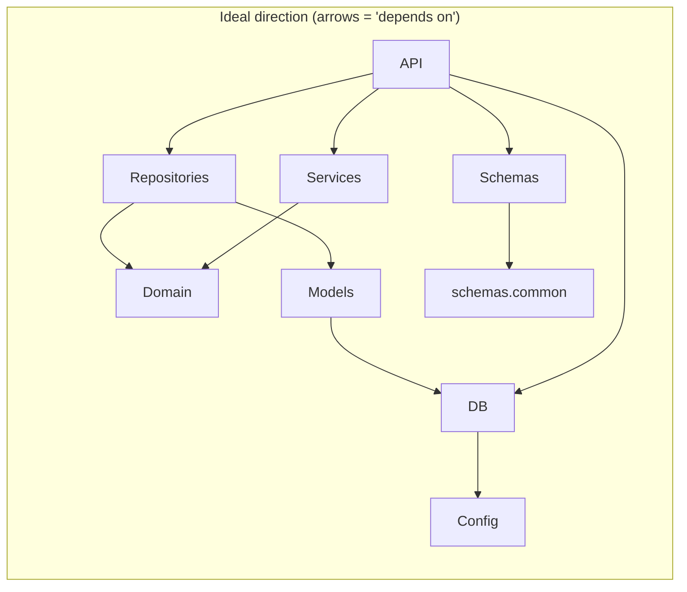
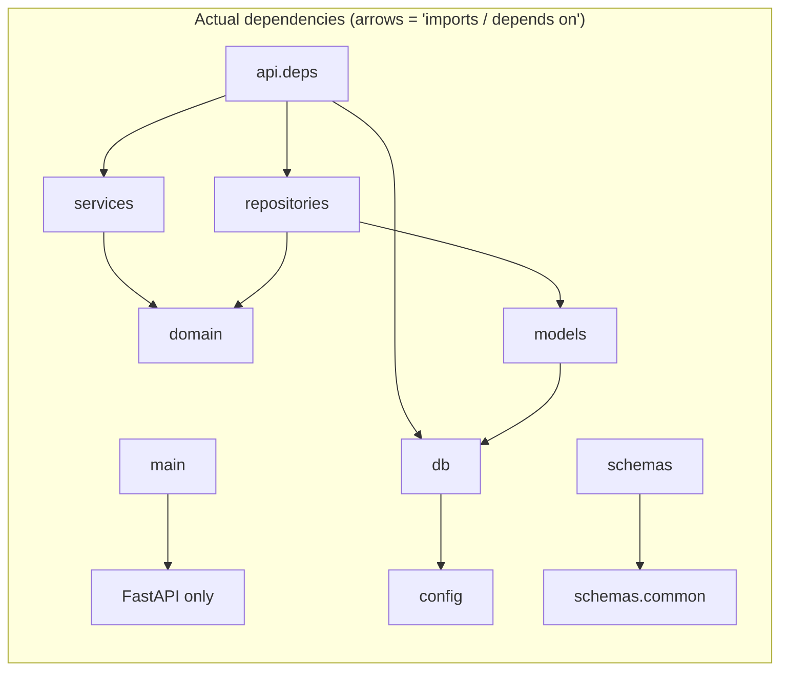

# Layer contracts and dependency boundaries

Per-layer contract: receives, produces, knows about, must NOT know about, and current violations. Followed by ideal vs actual dependency flowcharts.

---

## API (app.api: main.py, deps.py)

**Receives:** HTTP request (when routers are mounted); `Depends(get_session)` → `AsyncSession`; router handlers would receive `Depends(get_*_service)` → service instance.

**Produces:** Service instances (deps); HTTP response / JSON (main or future route handlers); no domain entities or ORM exposed at API boundary.

**Knows about:** `fastapi`, `sqlalchemy.ext.asyncio.AsyncSession`, `app.db.session` (get_session), `app.repositories.*` (concrete SQL repos), `app.services.*`.

**Must NOT know about:** `app.domain` (entities, value objects), `app.models` (ORM classes), `app.schemas` (deps may stay schema-agnostic; routers will use schemas for request/response).

**Current violations:** None. Deps is the composition root and is intended to know both repositories and services; it does not import domain or models.

---

## Schemas (app.schemas)

**Receives:** Request body / query (dict or parsed), type parameters for `PaginatedResponse[T]`; Pydantic receives raw input for validation.

**Produces:** Pydantic models (Create, Update, Read, list wrappers), serialized JSON for responses, validation errors (`ValidationError`).

**Knows about:** `pydantic`, `typing`, `datetime`, `uuid`, `re` (tools slug); `app.schemas.common` only (resource schemas import common).

**Must NOT know about:** `app.domain`, `app.models`, `app.api`, `app.services`, `app.repositories`, `app.db`.

**Current violations:** None. No imports of domain, models, api, services, repositories, or db.

---

## Services (app.services)

**Receives:** Repository port (ABC) and session-like object (Protocol with `async def commit()`); per-method: `dict[str, Any]` (create/update), `UUID` (get, update, deactivate), optional filters and pagination (list).

**Produces:** Domain entities (`Agent`, `Document`, etc.); raises domain exceptions (`AgentNotFound`, `DocumentNotBelongToAgent`, etc.); side effect: `session.commit()` on write paths.

**Knows about:** `app.domain.<aggregate>.entity`, `app.domain.<aggregate>.repository` (ABC), `app.domain.<aggregate>.exceptions`; stdlib (`datetime`, `uuid`, `typing`).

**Must NOT know about:** `app.models` (ORM), `app.repositories` (concrete impls), `app.api`, `app.schemas`, `app.db` (no direct import of session/engine; session is injected and used via Protocol).

**Current violations:** None. Services depend only on domain and a local `_CommitSession` Protocol.

---

## Domain (app.domain)

**Receives:** Constructor args for entities; repository methods receive `UUID` or entity instances; exceptions receive message/code.

**Produces:** Entities (dataclasses), repository port (ABC), domain exceptions; no I/O, no persistence.

**Knows about:** Stdlib only (`dataclasses`, `abc`, `datetime`, `uuid`); `app.domain.shared.exceptions`; sibling packages within domain (e.g. `app.domain.agents.entity` in `app.domain.agents.repository`).

**Must NOT know about:** `app.models`, `app.repositories`, `app.services`, `app.api`, `app.schemas`, `app.db`, `app.config`, FastAPI, SQLAlchemy, Pydantic.

**Current violations:** None. No imports from outside `app.domain`.

---

## Repositories (app.repositories)

**Receives:** `AsyncSession` (injected by deps), domain entities (create/update), `UUID` (get, delete), filter/pagination params (list).

**Produces:** Domain entities or `None`; raises domain exceptions (`AgentNotFound`, `DocumentNotFound`, etc.); side effect: SQL (flush only; no commit).

**Knows about:** `sqlalchemy`, `sqlalchemy.ext.asyncio.AsyncSession`; `app.domain.<aggregate>.entity`, `app.domain.<aggregate>.repository` (implements ABC), `app.domain.<aggregate>.exceptions`; `app.models.*` (ORM classes and enums).

**Must NOT know about:** `app.services`, `app.api`, `app.schemas` (repos are persistence adapters; they should not depend on HTTP or DTOs).

**Current violations:** None. Repositories do not import services, api, or schemas.

---

## Models / ORM (app.models)

**Receives:** Table definitions, relationship declarations; used by repositories and Alembic (read).

**Produces:** ORM-mapped classes, `target_metadata` for migrations; no business logic.

**Knows about:** `sqlalchemy`; `app.db.base.Base`; `app.db.uuid_default` (uuid7); sibling models (e.g. `BotConfig` imports `AgentTool`, `Document` for relationships).

**Must NOT know about:** `app.domain`, `app.services`, `app.api`, `app.repositories` (ORM is infrastructure; dependents are repos and Alembic, not the other way).

**Current violations:** None. Models do not import domain, services, api, or repositories.

---

## DB (app.db: session, base, uuid_default)

**Receives:** `settings.DATABASE_URL` (session); nothing (base, uuid_default).

**Produces:** `Base` (base.py), async engine and `get_session()` (session.py), `uuid7` (uuid_default.py); side effect: database connections.

**Knows about:** `sqlalchemy` (base, session); `uuid6` (uuid_default); `app.config.settings` (session only).

**Must NOT know about:** `app.domain`, `app.models`, `app.repositories`, `app.services`, `app.api` (db is low-level infra; models and session consumers depend on db, not the reverse).

**Current violations:** None. `app.db.session` imports `app.config` by design (engine needs URL).

---

## Config (app.config)

**Receives:** Environment variables, `.env` file.

**Produces:** `Settings` instance (e.g. `DATABASE_URL`).

**Knows about:** `pydantic_settings` only.

**Must NOT know about:** Any other app layer (domain, services, api, db, models, etc.).

**Current violations:** None.

---

## Ideal vs actual dependency direction

**Summary:** Ideal and actual align. The API (deps) is the only module that depends on both repositories and services; no layer imports domain or models from the wrong place, and no circular dependencies exist.
